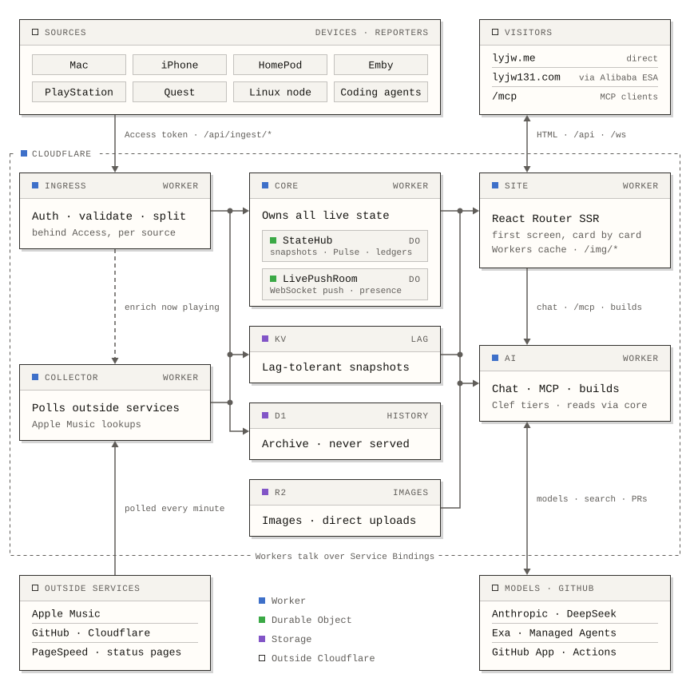
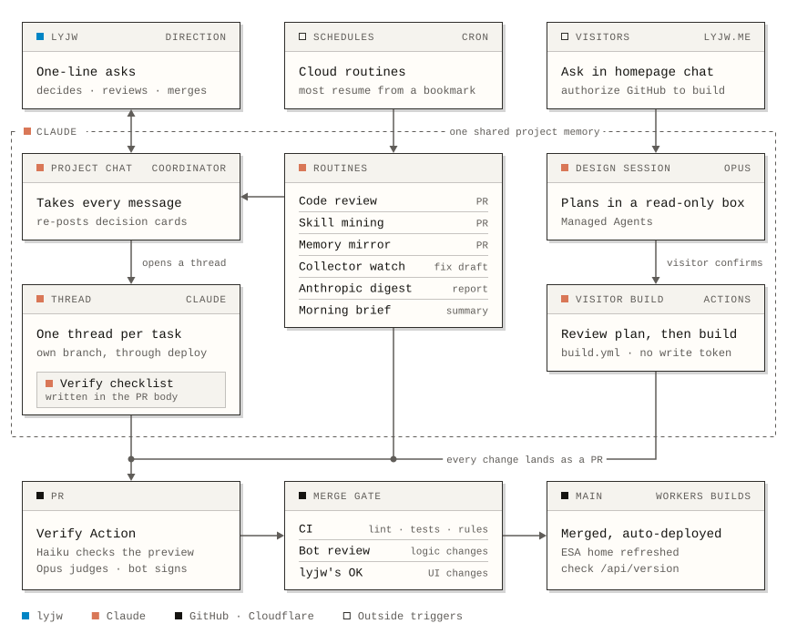

[中文](./README.md) · **English**

# lyjwpage

**A personal homepage driven by real devices and everyday activity.**

[Visit](https://lyjw.me) · [Mirror for mainland China](https://lyjw131.com)

How-it-works explainer: [中文](https://lyjw131.com/explainer/?lang=zh) · [English](https://lyjw.me/explainer/?lang=en)

What I'm listening to, watching and playing, which apps are in use, how my devices are doing: this homepage gathers state scattered across a Mac, an iPhone, a NAS and cloud services onto one page. It is also a personal telemetry system that keeps evolving.

## What's on the page

| Module | What it shows |
| --- | --- |
| **Daily digest** | A tagline and a few readings sum up the last 24 hours, with a 24-hour dial |
| **This Mac and chargers** | The Mac's front app and window title; ports and power of Anker chargers and power banks |
| **Do Not Disturb** | The iPhone Focus mode and how long it has been on |
| **Watching / Music** | Now playing on Emby; Apple Music and HomePod with word-by-word lyrics, plus a web player visitors can listen along with |
| **Activity** | Apple Watch rings and recent workouts |
| **Server** | Exit node rates, traffic, CPU, memory and disk |
| **AI Coding** | Token usage per coding tool, cost estimates, the agent in use, a yearly heatmap and limits |
| **Games** | Now playing on Meta Quest and PlayStation; PlayStation online status and trophies |
| **Pulse** | A 24-hour timeline of coding, tokens, listening, watching, playing, charging and activity |
| **Provider status** | Official status pages of Claude, ChatGPT, Cursor, GitHub, Cloudflare and more |
| **The site itself** | Repository and commits, 30-day uptime, performance scores, Worker and reporter metrics |
| **Talk to God** | Visitors pick a DeepSeek or Claude lineup and each question goes to a tier by difficulty; it can read every card's live data, search the web, draw cards in its answers and plan site changes |

The same data is open to AI agents: `https://lyjw.me/mcp` is a public MCP endpoint (Streamable HTTP; public tools need no auth, and LYJW can sign in with GitHub to read the private history).

## Screenshots

The cards below are rendered live by the site as SVG, follow the system light or dark theme and show the capture time in the card header. Status cards such as now watching, now listening and charging only appear while that thing is happening; when it is not, they are filled with sample data and marked Sample data. How it works: [docs/screenshots.md](./docs/screenshots.md); card details: [page details and key design choices](./docs/design-notes.md) (Chinese).

**Front app in the header**: Claude Code, Ghostty, Cursor and Antigravity get animated brand marks; a window title shows only after it passes a privacy check.

<picture>
  <source media="(prefers-color-scheme: dark)" srcset="https://lyjw.me/readme/desktop-marks-dark.svg">
  
</picture>

**Cloudflare outage banner**: appears at the top of the homepage, with its duration, when a Cloudflare component the site depends on has a major outage.

<picture>
  <source media="(prefers-color-scheme: dark)" srcset="https://lyjw.me/cards/cloudflare-outage.svg?theme=dark&amp;v=1">
  
</picture>

**Profile and daily digest**

<picture><source media="(prefers-color-scheme: dark)" srcset="https://lyjw.me/cards/contact.svg?theme=dark&amp;v=1"></picture><picture><source media="(prefers-color-scheme: dark)" srcset="https://lyjw.me/cards/digest.svg?theme=dark&amp;v=3"></picture>

**Now watching on Emby**

<picture>
  <source media="(prefers-color-scheme: dark)" srcset="https://lyjw.me/cards/now-watching.svg?theme=dark&amp;v=2">
  
</picture>

**Do Not Disturb**

<picture>
  <source media="(prefers-color-scheme: dark)" srcset="https://lyjw.me/cards/focus.svg?theme=dark&amp;v=3">
  
</picture>

**Now playing on Meta Quest**

<picture>
  <source media="(prefers-color-scheme: dark)" srcset="https://lyjw.me/cards/quest.svg?theme=dark&amp;v=3">
  
</picture>

**Now playing on PlayStation**

<picture>
  <source media="(prefers-color-scheme: dark)" srcset="https://lyjw.me/cards/playstation-now.svg?theme=dark&amp;v=1">
  
</picture>

**Charger and power bank**

<picture><source media="(prefers-color-scheme: dark)" srcset="https://lyjw.me/cards/charger.svg?theme=dark&amp;v=2"></picture><picture><source media="(prefers-color-scheme: dark)" srcset="https://lyjw.me/cards/powerbank.svg?theme=dark&amp;v=2"></picture>

**Now playing on Apple Music**: word-by-word synced lyrics, with recently played below.

<picture>
  <source media="(prefers-color-scheme: dark)" srcset="https://lyjw.me/cards/now-listening.svg?theme=dark&amp;v=2">
  
</picture>

**Talk to God**

<picture>
  <source media="(prefers-color-scheme: dark)" srcset="https://lyjw.me/cards/chat.svg?theme=dark&amp;v=2">
  
</picture>

**Activity and workouts**

<picture>
  <source media="(prefers-color-scheme: dark)" srcset="https://lyjw.me/cards/activity.svg?theme=dark&amp;v=2">
  
</picture>

**Exit node**

<picture>
  <source media="(prefers-color-scheme: dark)" srcset="https://lyjw.me/cards/server.svg?theme=dark&amp;v=2">
  
</picture>

**AI Coding**: merged from the Mac's local logs, Cursor account history and Claude Code cloud telemetry.

<picture>
  <source media="(prefers-color-scheme: dark)" srcset="https://lyjw.me/cards/vibe-coding.svg?theme=dark&amp;v=2">
  
</picture>

**PlayStation**

<picture>
  <source media="(prefers-color-scheme: dark)" srcset="https://lyjw.me/cards/playstation.svg?theme=dark&amp;v=2">
  
</picture>

**Pulse**: on the page, hover any segment to see the state and title at that time.

<picture>
  <source media="(prefers-color-scheme: dark)" srcset="https://lyjw.me/cards/pulse.svg?theme=dark&amp;v=2">
  
</picture>

**Provider status**

<picture>
  <source media="(prefers-color-scheme: dark)" srcset="https://lyjw.me/cards/provider-status.svg?theme=dark&amp;v=2">
  
</picture>

**The site itself**

<picture>
  <source media="(prefers-color-scheme: dark)" srcset="https://lyjw.me/cards/site-status.svg?theme=dark&amp;v=2">
  
</picture>

## Architecture

**Collectors adapt each source, Cloudflare Workers hold the state, and the site Worker (React Router SSR) renders the page.**

<picture>
  <source media="(prefers-color-scheme: dark)" srcset="docs/diagrams/architecture-en-dark.svg">
  
</picture>

- **Collectors** run where the data is produced: the Mac, iPhone, NAS, Linux reporters, Home Assistant and Claude Code cloud telemetry. External services (Apple Music, GitHub, Cloudflare, PageSpeed) are polled by the collector Worker.
- **State hub**: the ingress Worker checks identity behind Cloudflare Access and validates each report; realtime data goes to the core Worker's Durable Objects, lag-tolerant data to KV, archives to D1 and images to R2.
- **Frontend**: the site Worker renders the home page card by card, then WebSocket pushes and polling keep it current; visitors in mainland China go through Alibaba Cloud ESA.

[Page details and key design choices](./docs/design-notes.md) (Chinese: first-screen caching, push vs. polling, stale-tab degradation, window-title privacy check, image addressing, observability)

## Development workflow

Most of the code in this repo is written by Claude; lyjw sets direction, makes the calls and signs off. A one-line request goes into the project chat, a coordinator Claude opens a thread, and that thread's Claude carries the work through merge and deploy. Scheduled agents keep reviewing code, distilling lessons and watching production when nobody is talking.

<picture>
  <source media="(prefers-color-scheme: dark)" srcset="docs/diagrams/workflow-en-dark.svg">
  
</picture>

- **Layered rules, enforced where possible**: [`HUMAN.md`](./HUMAN.md) is the collaboration contract for lyjw, [`AGENTS.md`](./AGENTS.md) holds the hard rules for agents, [`.claude/skills/`](./.claude/skills/) holds reusable procedures. Hooks, lint and the CI checks `docs:check`, `rules:check` and `design:scale` block violations, and the baselines of existing violations can only shrink.
- **Verification leaves a receipt**: checks run on a Haiku verifier that signs a graded receipt per commit SHA; before merge a script confirms the receipt still covers the current head.
- **Tiered merge gate**: docs and small changes merge once local checks pass without waiting for CI, large logic changes need green CI and clear bot reviews first, UI changes wait for lyjw to approve screenshots.
- **Self-improving**: scheduled agents turn recurring procedures into skills and adopted review findings into checks; project memory is mirrored in [`.claude/memory/`](./.claude/memory/MEMORY.md).
- **Visitors can change the site too**: describe a change in the homepage chat, and Claude plans, reviews and implements it as a PR for lyjw to merge.

The full picture (in Chinese): [Development workflow](./docs/workflow.md).

## Tech stack

| Layer | Main technologies |
| --- | --- |
| Pages and types | React Router 8 · Vite · React 19 (React Compiler) · TypeScript 7 |
| Styling and interaction | Tailwind CSS 4 · Motion · Number Flow · Geist |
| Client data | SWR · WebSocket |
| State and asset storage | Cloudflare Workers · Durable Objects SQLite · KV · D1 · R2 |
| Homepage chat | DeepSeek Flash and Anthropic Claude (routed by Clef), Exa web search, Cloudflare Turnstile |
| Native device integration | Swift / SwiftUI · HealthKit · BLE |
| Hosting and delivery | Cloudflare Workers · Alibaba Cloud ESA |
| Error and performance monitoring | Cloudflare Workers Observability · Web Analytics |

## Where to start reading

| If you want to know | Start here |
| --- | --- |
| How the homepage assembles its modules | [`src/app/page.tsx`](./src/app/page.tsx) · [`src/components/live/`](./src/components/live/) |
| How the first paint reads and caches state per card | [`src/lib/first-screen.ts`](./src/lib/first-screen.ts) |
| How status views are registered on both sides | [`shared/status-views.ts`](./shared/status-views.ts) · [`workers/core/src/status-loaders.ts`](./workers/core/src/status-loaders.ts) |
| How push and polling update the same client state | [`src/hooks/use-live-events.ts`](./src/hooks/use-live-events.ts) · [`src/hooks/use-status.ts`](./src/hooks/use-status.ts) · [`src/lib/status-reads.ts`](./src/lib/status-reads.ts) |
| How the web player and lyrics work | [`src/hooks/use-web-player.ts`](./src/hooks/use-web-player.ts) · [`src/hooks/use-lyrics.ts`](./src/hooks/use-lyrics.ts) |
| How reports are authenticated, validated and split by data layer | [`workers/ingress/`](./workers/ingress/) |
| How state storage, live push and the public API are organized | [`workers/core/`](./workers/core/) |
| How homepage chat, MCP and model tools run | [`workers/ai/`](./workers/ai/) |
| How each device and service is connected | [`reporters/`](./reporters/) · [`workers/collector/`](./workers/collector/) |
| How the native iOS app reads the site and reports | [`apps/ios/`](./apps/ios/) |
| How online visitors are counted | [`workers/core/src/live-census.ts`](./workers/core/src/live-census.ts) · [`src/hooks/use-live-events.ts`](./src/hooks/use-live-events.ts) |

The Mac collector [MacTelemetryHub](https://github.com/LYJW131/MacTelemetryHub) is a submodule at `reporters/mac-telemetry-hub/`. For local development, see "本地开发" in [`workers/core/README.md`](./workers/core/README.md).

## Further reading

- [Telemetry and realtime subsystems](./docs/telemetry-subsystems.md): how each source connects and its protocol
- [Worker data backend and first-screen caching](./docs/state-storage.md): storage layers, public data boundary and cache invalidation
- [lyjwpage iOS App](./apps/ios/README.md): native client and iPhone reporter
- [Discord Gateway reporter](./reporters/discord-reporter/README.md): live Quest game data
- [Docs index](./docs/README.md)
