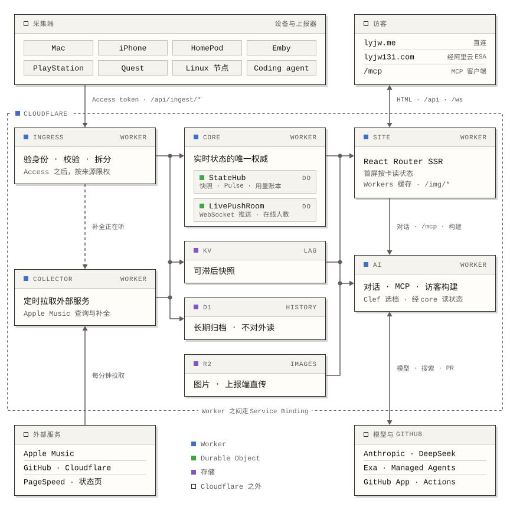
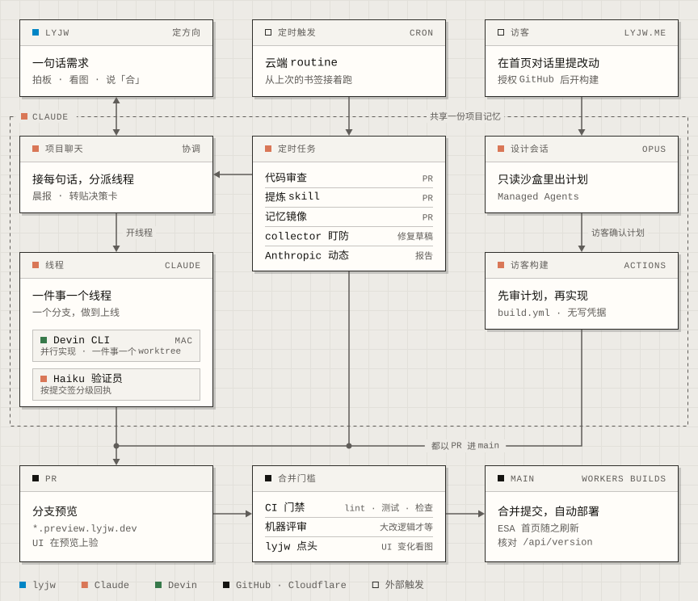

**中文** · [English](./README.en.md)

# lyjwpage

**一个由真实设备与日常活动驱动的个人主页。**

[在线访问](https://lyjw.me) · [中国大陆访问](https://lyjw131.com)

运行原理讲解动画：[中文](https://lyjw131.com/explainer/?lang=zh) · [English](https://lyjw.me/explainer/?lang=en)

听什么、看什么、玩什么，正在用哪些应用，设备状态如何：这个主页把 Mac、iPhone、NAS 和云端服务里分散的状态汇到同一页，也是一套持续演进的个人遥测系统。

## 页面里有什么

| 模块 | 内容 |
| --- | --- |
| **每日摘要** | 一句标语加几项读数概括最近 24 小时，配 24 小时表盘 |
| **本机与充电** | Mac 前台应用与窗口标题，Anker 充电头、充电宝的端口与功率 |
| **勿扰** | iPhone 专注模式与已持续时长 |
| **影视 / 音乐** | Emby 正在播放；Apple Music 与 HomePod 在听、逐字歌词，访客可用网页播放器「一起听」 |
| **运动** | Apple Watch 三环与最近训练 |
| **服务器** | 落地节点的速率、流量、CPU、内存、磁盘 |
| **AI Coding** | 各编码工具的 Token 用量、成本估算、在用的 agent、年度热力图与限额 |
| **游戏** | Meta Quest 与 PlayStation 正在玩；PlayStation 在线状态与奖杯 |
| **Pulse** | 编码、Token、听、看、玩、充电、运动的 24 小时时间线 |
| **服务状态** | Claude、ChatGPT、Cursor、GitHub、Cloudflare 等官方状态页汇总 |
| **站点自身** | 仓库与提交、30 天在线状态、性能分、各 Worker 与上报器指标 |
| **与神对话** | 访客选 DeepSeek 或 Claude 阵容，按问题难度派档，可读各卡实时数据、联网搜索、在回答里画卡片、规划站点改动 |

同一套数据也开放给 AI：`https://lyjw.me/mcp` 是公开 MCP 端点（Streamable HTTP，无需鉴权）。

## 页面效果

下面的卡片由站点实时渲染成 SVG，明暗跟随系统，卡头标出抓取时间。正在看、正在听、充电这类状态卡片只在对应的事情发生时出现，此刻没发生的用示例数据补上并标 Sample data。做法见 [docs/screenshots.md](./docs/screenshots.md)，各卡细节见 [页面细节与关键设计](./docs/design-notes.md)。

**页头前台应用**：Claude Code、Ghostty、Cursor、Antigravity 换成品牌动画，窗口标题过了隐私判断才显示。

<picture>
  <source media="(prefers-color-scheme: dark)" srcset="https://lyjw.me/readme/desktop-marks-dark.svg">
  
</picture>

**Cloudflare 故障横幅**：站点依赖的 Cloudflare 组件严重故障时出现在首页最上方，带持续时间。

<picture>
  <source media="(prefers-color-scheme: dark)" srcset="https://lyjw.me/cards/cloudflare-outage.svg?theme=dark&amp;v=1">
  
</picture>

**个人信息与每日摘要**

<picture><source media="(prefers-color-scheme: dark)" srcset="https://lyjw.me/cards/contact.svg?theme=dark&amp;v=1"></picture><picture><source media="(prefers-color-scheme: dark)" srcset="https://lyjw.me/cards/digest.svg?theme=dark&amp;v=3"></picture>

**Emby 正在播放**

<picture>
  <source media="(prefers-color-scheme: dark)" srcset="https://lyjw.me/cards/now-watching.svg?theme=dark&amp;v=2">
  
</picture>

**勿扰**

<picture>
  <source media="(prefers-color-scheme: dark)" srcset="https://lyjw.me/cards/focus.svg?theme=dark&amp;v=3">
  
</picture>

**Meta Quest 正在玩**

<picture>
  <source media="(prefers-color-scheme: dark)" srcset="https://lyjw.me/cards/quest.svg?theme=dark&amp;v=3">
  
</picture>

**PlayStation 正在玩**

<picture>
  <source media="(prefers-color-scheme: dark)" srcset="https://lyjw.me/cards/playstation-now.svg?theme=dark&amp;v=1">
  
</picture>

**充电头与充电宝**

<picture><source media="(prefers-color-scheme: dark)" srcset="https://lyjw.me/cards/charger.svg?theme=dark&amp;v=2"></picture><picture><source media="(prefers-color-scheme: dark)" srcset="https://lyjw.me/cards/powerbank.svg?theme=dark&amp;v=2"></picture>

**Apple Music 正在播放**：逐字高亮的同步歌词，下方是最近收听。

<picture>
  <source media="(prefers-color-scheme: dark)" srcset="https://lyjw.me/cards/now-listening.svg?theme=dark&amp;v=2">
  
</picture>

**与神对话**

<picture>
  <source media="(prefers-color-scheme: dark)" srcset="https://lyjw.me/cards/chat.svg?theme=dark&amp;v=2">
  
</picture>

**活动与训练**

<picture>
  <source media="(prefers-color-scheme: dark)" srcset="https://lyjw.me/cards/activity.svg?theme=dark&amp;v=2">
  
</picture>

**落地节点**

<picture>
  <source media="(prefers-color-scheme: dark)" srcset="https://lyjw.me/cards/server.svg?theme=dark&amp;v=2">
  
</picture>

**AI Coding**：Mac 本机日志、Cursor 账号历史与 Claude Code 云端遥测合并计算。

<picture>
  <source media="(prefers-color-scheme: dark)" srcset="https://lyjw.me/cards/vibe-coding.svg?theme=dark&amp;v=2">
  
</picture>

**PlayStation**

<picture>
  <source media="(prefers-color-scheme: dark)" srcset="https://lyjw.me/cards/playstation.svg?theme=dark&amp;v=2">
  
</picture>

**Pulse**：页面上悬停任一时段看当时的状态与标题。

<picture>
  <source media="(prefers-color-scheme: dark)" srcset="https://lyjw.me/cards/pulse.svg?theme=dark&amp;v=2">
  
</picture>

**服务状态**

<picture>
  <source media="(prefers-color-scheme: dark)" srcset="https://lyjw.me/cards/provider-status.svg?theme=dark&amp;v=2">
  
</picture>

**站点自身**

<picture>
  <source media="(prefers-color-scheme: dark)" srcset="https://lyjw.me/cards/site-status.svg?theme=dark&amp;v=2">
  
</picture>

## 系统架构

**采集端适配不同来源，Cloudflare Workers 统一管理状态，site Worker（React Router SSR）负责页面。**

<picture>
  <source media="(prefers-color-scheme: dark)" srcset="docs/diagrams/architecture-zh-dark.svg">
  
</picture>

- **采集端**跑在数据产生的地方：Mac、iPhone、NAS、Linux 上报器、Home Assistant、Claude Code 云端遥测；外部服务（Apple Music、GitHub、Cloudflare、PageSpeed）由采集 Worker 定时拉取。
- **状态中枢**：上报入口 Worker 在 Cloudflare Access 之后验身份、校验，实时数据交给持有 Durable Objects 的 core Worker，可滞后数据写 KV，归档进 D1，图片进 R2。
- **展示端**：site Worker 按卡读状态生成首页，之后由 WebSocket 推送与轮询追上；中国大陆入口经阿里云 ESA 加速。

[页面细节与关键设计](./docs/design-notes.md)（首屏缓存、推送与轮询分工、旧页面降级、窗口标题隐私判断、图片寻址、可观测性）

## 开发工作流

这个仓库的代码大多由 Claude 写，lyjw 定方向、拍板和验收。一句话需求进项目聊天，协调 Claude 开线程，线程 Claude 一路做到合并上线；几个定时任务在没人说话时继续审查代码、提炼经验、盯线上。

<picture>
  <source media="(prefers-color-scheme: dark)" srcset="docs/diagrams/workflow-zh-dark.svg">
  
</picture>

- **规则分层，能拦就拦**：[`HUMAN.md`](./HUMAN.md) 是给 lyjw 的协作约定，[`AGENTS.md`](./AGENTS.md) 是给 agent 的硬规则，[`.claude/skills/`](./.claude/skills/) 是可复用流程；违反时由钩子、lint 和 CI 里的 `docs:check`、`rules:check`、`design:scale` 拦下，存量违规的基线只减不增。
- **验证有回执**：PR 上由 GitHub Action 派 Haiku 验证员照 PR 里的清单验、Opus 判定员对照原话判，回执按提交 SHA 分级、由 bot 贴出，合并前脚本核对回执还盖得住当前提交。
- **合并分档**：文档和小改动本地检查过了就合、不等 CI，大改逻辑的处理完机器评审，UI 变化等 lyjw 看图点头。
- **自我改进**：定时任务把反复出现的流程写成 skill、把被采纳的评审意见做成检查，项目记忆镜像在 [`.claude/memory/`](./.claude/memory/MEMORY.md)。
- **访客也能改站点**：在首页对话里描述改动，Claude 规划、审查、实现，产出 PR 交 lyjw 合并。

全貌见 [人与 agent 的开发工作流](./docs/workflow.md)。

## 技术组成

| 层次 | 主要技术 |
| --- | --- |
| 页面与类型 | React Router 8 · Vite · React 19（React Compiler） · TypeScript 7 |
| 样式与交互 | Tailwind CSS 4 · Motion · Number Flow · Geist |
| 客户端数据 | SWR · WebSocket |
| 状态与资源存储 | Cloudflare Workers · Durable Objects SQLite · KV · D1 · R2 |
| 首页对话 | DeepSeek Flash 与 Anthropic Claude（Clef 选档、Clairic 抽取）、Exa 联网搜索、Cloudflare Turnstile |
| 原生设备接入 | Swift / SwiftUI · HealthKit · BLE |
| 页面托管与分发 | Cloudflare Workers · 阿里云 ESA |
| 报错与性能监控 | Cloudflare Workers Observability · Web Analytics |

## 从哪里读源码

| 想了解什么 | 阅读入口 |
| --- | --- |
| 首页如何组合各个模块 | [`src/app/page.tsx`](./src/app/page.tsx) · [`src/components/live/`](./src/components/live/) |
| 首屏如何按卡读取和缓存状态 | [`src/lib/first-screen.ts`](./src/lib/first-screen.ts) |
| 状态视图在两侧如何登记 | [`shared/status-views.ts`](./shared/status-views.ts) · [`workers/core/src/status-loaders.ts`](./workers/core/src/status-loaders.ts) |
| 推送与轮询如何更新同一份客户端状态 | [`src/hooks/use-live-events.ts`](./src/hooks/use-live-events.ts) · [`src/hooks/use-status.ts`](./src/hooks/use-status.ts) · [`src/lib/status-reads.ts`](./src/lib/status-reads.ts) |
| 网页播放器与歌词如何工作 | [`src/hooks/use-web-player.ts`](./src/hooks/use-web-player.ts) · [`src/hooks/use-lyrics.ts`](./src/hooks/use-lyrics.ts) |
| 上报如何鉴权、校验与按数据层拆分 | [`workers/ingress/`](./workers/ingress/) |
| 状态存储、实时推送与公开 API 如何组织 | [`workers/core/`](./workers/core/) |
| 首页对话、MCP 与模型工具如何运行 | [`workers/ai/`](./workers/ai/) |
| 各类设备与服务如何接入 | [`reporters/`](./reporters/) · [`workers/collector/`](./workers/collector/) |
| 原生 iOS App 如何读站点、如何上报 | [`apps/ios/`](./apps/ios/) |
| 在线访客如何统计 | [`workers/core/src/live-census.ts`](./workers/core/src/live-census.ts) · [`src/hooks/use-live-events.ts`](./src/hooks/use-live-events.ts) |

Mac 端采集器 [MacTelemetryHub](https://github.com/LYJW131/MacTelemetryHub) 以 submodule 接入 `reporters/mac-telemetry-hub/`。本地开发见 [`workers/core/README.md`](./workers/core/README.md)「本地开发」。

## 进一步了解

- [遥测与实时状态子系统](./docs/telemetry-subsystems.md)：各数据源的接入方式与协议
- [Worker 数据后端与首屏缓存](./docs/state-storage.md)：存储分层、公开数据边界与缓存失效
- [lyjwpage iOS App](./apps/ios/README.md)：原生客户端与 iPhone 端上报器
- [Discord Gateway 上报器](./reporters/discord-reporter/README.md)：Quest 游戏实时数据
- [文档索引](./docs/README.md)
