

**中文** · [English](./README.en.md)

# lyjwpage

**一个由真实设备与日常活动驱动的个人主页。**

[在线访问](https://lyjw.me) · [中国大陆访问](https://lyjw131.com) · [交互式架构图](https://lyjw131.github.io/lyjwpage/)

运行原理讲解动画：[中文](https://lyjw131.com/explainer/?lang=zh) · [English](https://lyjw.me/explainer/?lang=en)

听什么、看什么、玩什么，正在用哪些应用，设备状态如何：这个主页把 Mac、iPhone、NAS 和云端服务里分散的状态汇到同一页，也是一套持续演进的个人遥测系统。

<picture>
  <source media="(prefers-color-scheme: dark)" srcset="docs/screenshots/overview-dark.webp">
  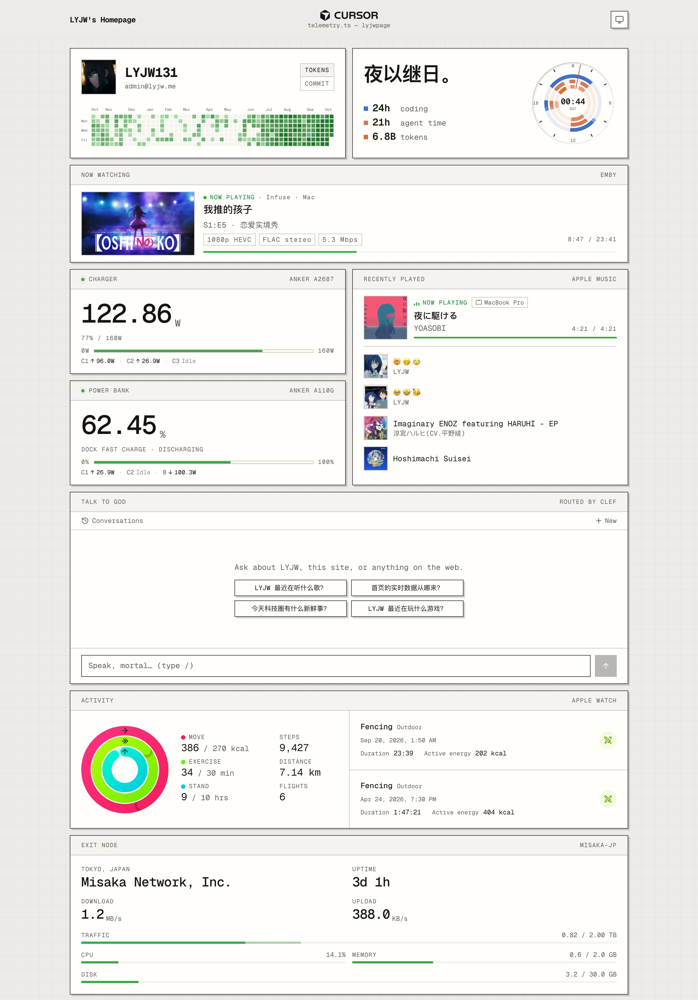
</picture>

## 页面里有什么

| 模块 | 内容 |
| --- | --- |
| **每日摘要** | 一句标语加几项读数概括最近 24 小时，配 24 小时表盘 |
| **本机与充电** | Mac 前台应用与窗口标题，Anker 充电头、充电宝的端口与功率 |
| **影视 / 音乐** | Emby 正在播放；Apple Music 与 HomePod 在听、逐字歌词，访客可用网页播放器「一起听」 |
| **运动** | Apple Watch 三环与最近训练 |
| **服务器** | 落地节点的速率、流量、CPU、内存、磁盘 |
| **AI Coding** | 各编码工具的 Token 用量、成本估算、在用的 agent、年度热力图与限额 |
| **游戏** | PlayStation 在线状态与奖杯 |
| **Pulse** | 编码、听、看、玩、充电、运动的 24 小时时间线 |
| **服务状态** | Claude、ChatGPT、Cursor、GitHub、Cloudflare 等官方状态页汇总 |
| **站点自身** | 仓库与提交、30 天在线状态、性能分、各 Worker 与上报器指标 |
| **与神对话** | 按问题难度派给不同档位的 Claude，可读各卡实时数据、联网搜索、规划站点改动 |

同一套数据也开放给 AI：`https://lyjw.me/mcp` 是公开 MCP 端点（Streamable HTTP，无需鉴权）。

## 页面效果

正在看、正在听、充电、游戏这类状态卡片只在对应的事情发生时出现。下面的图在本地用示例数据把这些状态同时点亮，明暗跟随系统；录制方法见 [docs/screenshots.md](./docs/screenshots.md)，各卡细节见 [页面细节与关键设计](./docs/design-notes.md)。

**页头前台应用**：Claude Code、Ghostty、Cursor、Antigravity 换成品牌动画，窗口标题过了隐私判断才显示。

<picture>
  <source media="(prefers-color-scheme: dark)" srcset="docs/screenshots/desktop-marks-dark.gif">
  
</picture>

**每日摘要**

<picture>
  <source media="(prefers-color-scheme: dark)" srcset="docs/screenshots/digest-dark.webp">
  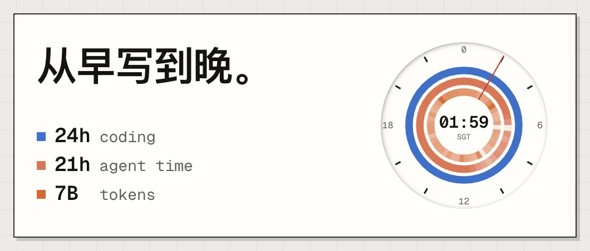
</picture>

**Emby 正在播放**

<picture>
  <source media="(prefers-color-scheme: dark)" srcset="docs/screenshots/now-watching-dark.webp">
  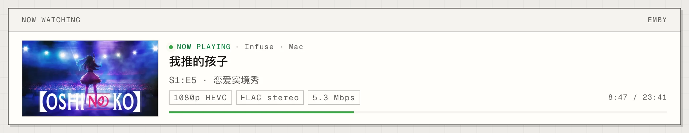
</picture>

**充电头与充电宝**

<table>
  <tr>
    <td width="50%">
      <picture>
        <source media="(prefers-color-scheme: dark)" srcset="docs/screenshots/charger-dark.gif">
        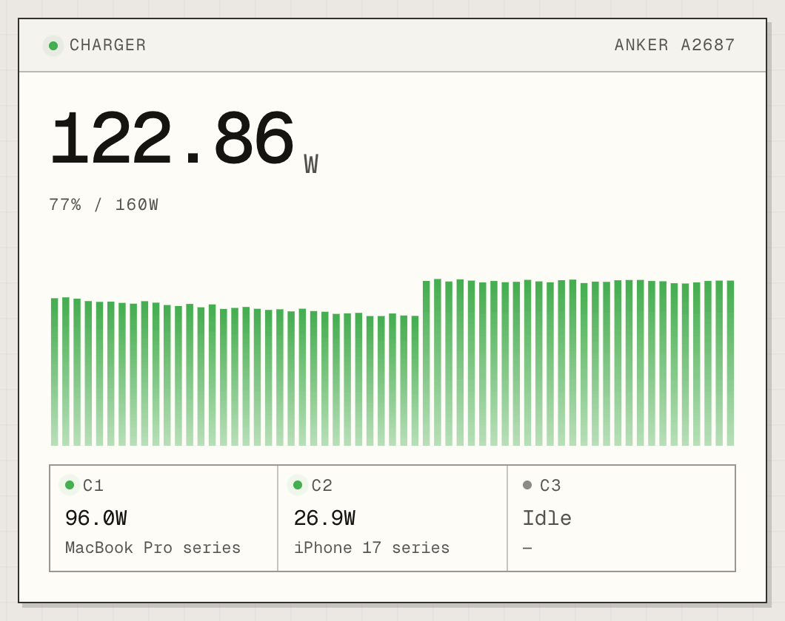
      </picture>
    </td>
    <td width="50%">
      <picture>
        <source media="(prefers-color-scheme: dark)" srcset="docs/screenshots/powerbank-dark.webp">
        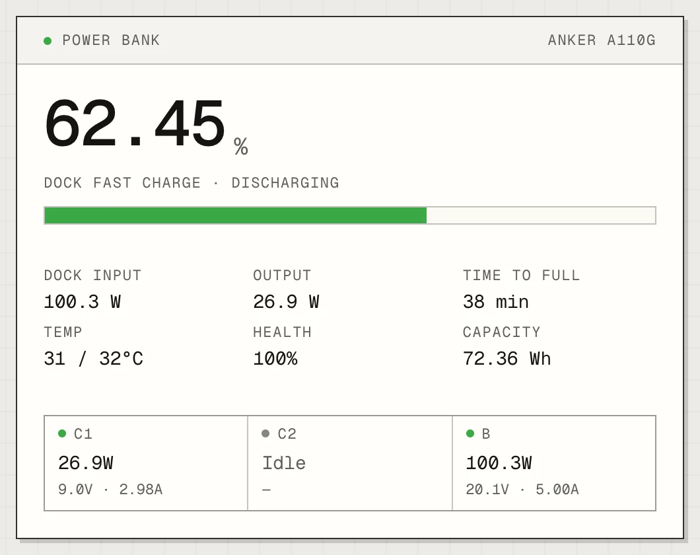
      </picture>
    </td>
  </tr>
</table>

**Apple Music 正在播放**：逐字高亮的同步歌词，下方是最近收听。

<picture>
  <source media="(prefers-color-scheme: dark)" srcset="docs/screenshots/now-listening-dark.gif">
  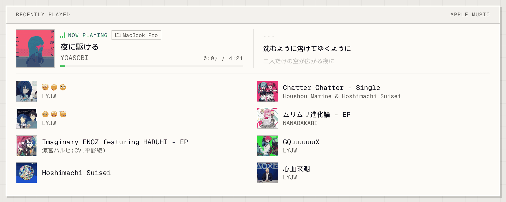
</picture>

**与神对话**

<picture>
  <source media="(prefers-color-scheme: dark)" srcset="docs/screenshots/chat-dark.webp">
  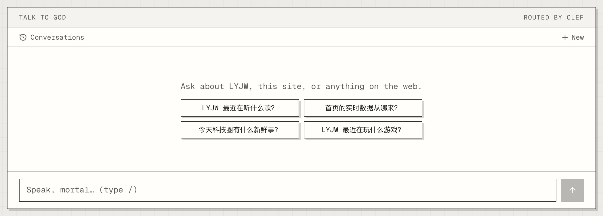
</picture>

**活动与训练**

<picture>
  <source media="(prefers-color-scheme: dark)" srcset="docs/screenshots/activity-dark.gif">
  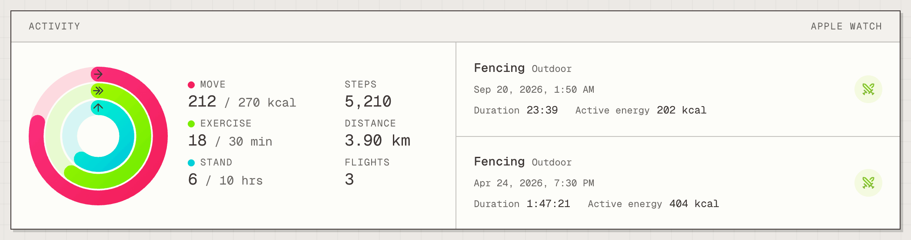
</picture>

**落地节点**

<picture>
  <source media="(prefers-color-scheme: dark)" srcset="docs/screenshots/server-dark.gif">
  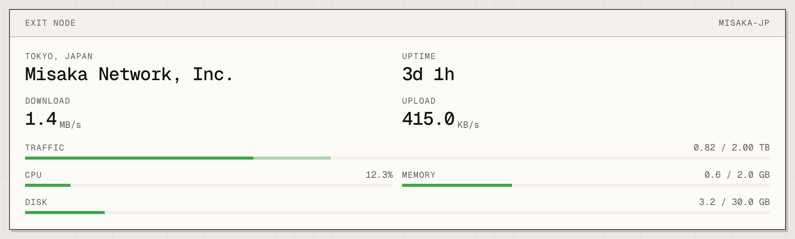
</picture>

**AI Coding**：Mac 本机日志、Cursor 账号历史与 Claude Code 云端遥测合并计算。

<picture>
  <source media="(prefers-color-scheme: dark)" srcset="docs/screenshots/vibecoding-dark.gif">
  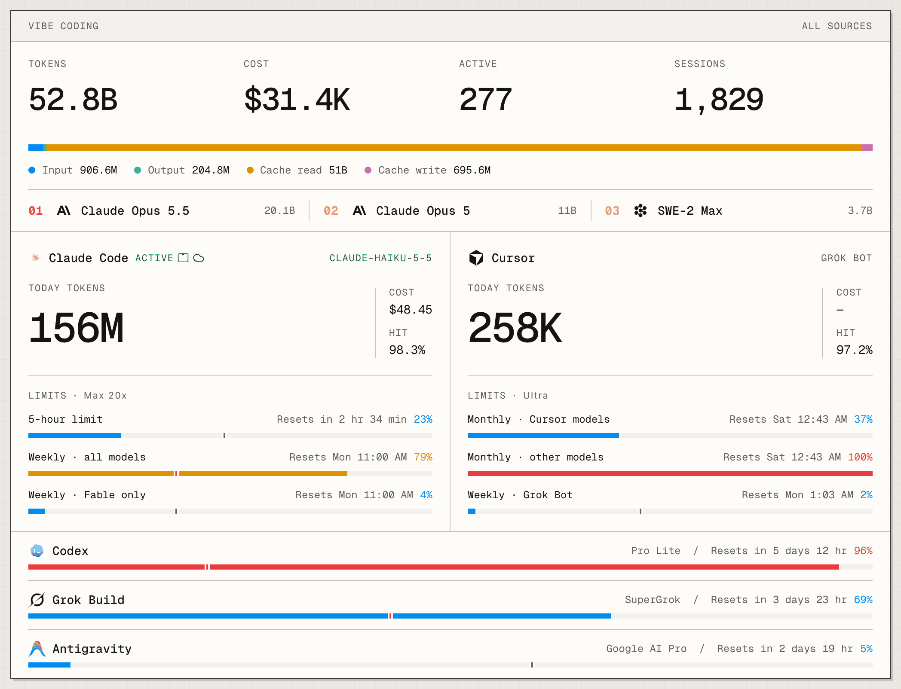
</picture>

**PlayStation**

<picture>
  <source media="(prefers-color-scheme: dark)" srcset="docs/screenshots/playstation-trophies-dark.webp">
  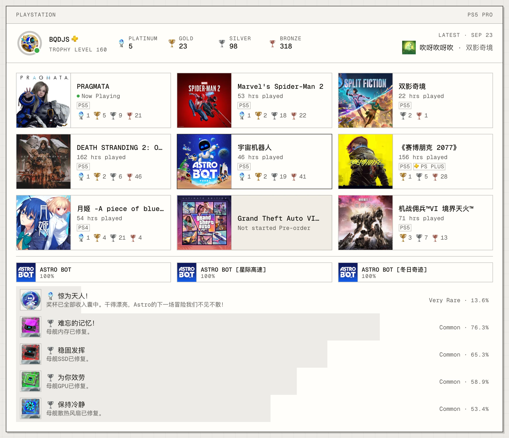
</picture>

**Pulse**：悬停任一时段看当时的状态与标题。

<picture>
  <source media="(prefers-color-scheme: dark)" srcset="docs/screenshots/pulse-detail-dark.webp">
  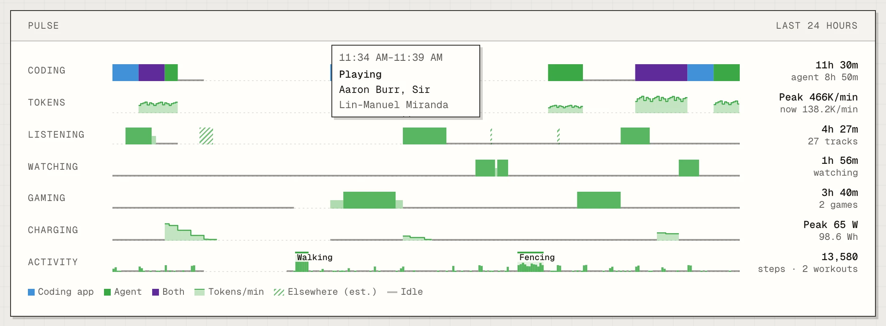
</picture>

**服务状态**

<picture>
  <source media="(prefers-color-scheme: dark)" srcset="docs/screenshots/provider-status-dark.webp">
  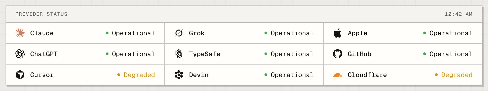
</picture>

**站点自身**

<picture>
  <source media="(prefers-color-scheme: dark)" srcset="docs/screenshots/site-status-dark.webp">
  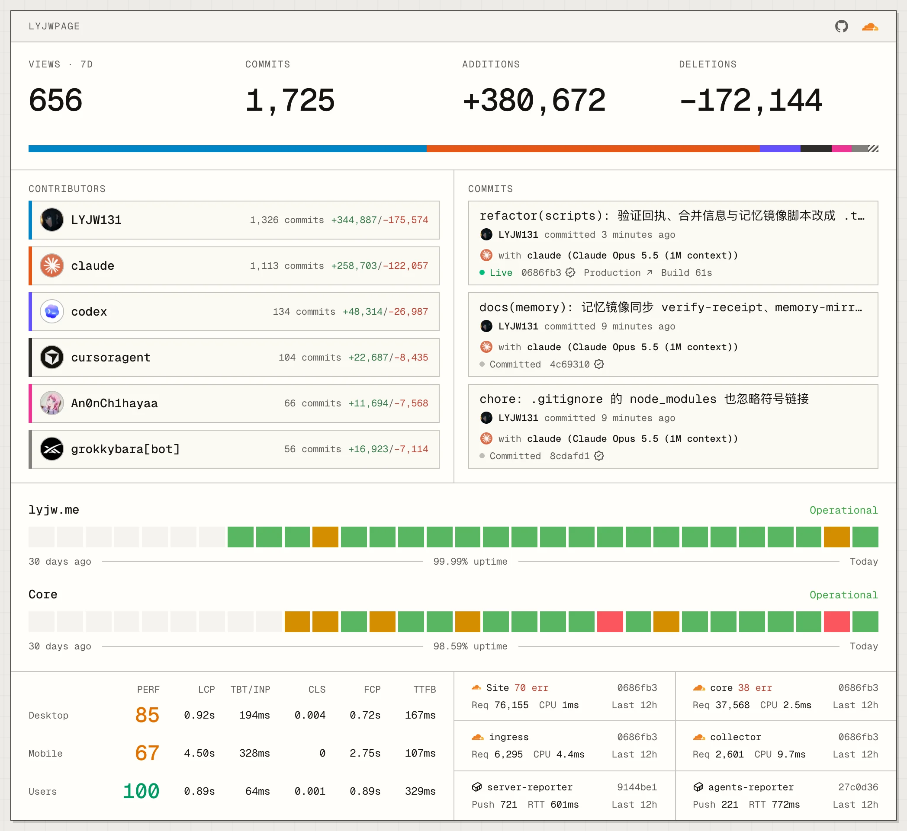
</picture>

## 系统架构

**采集端适配不同来源，Cloudflare Workers 统一管理状态，site Worker（React Router SSR）负责页面。**

<picture>
  <source media="(prefers-color-scheme: dark)" srcset="docs/architecture-dark.png">
  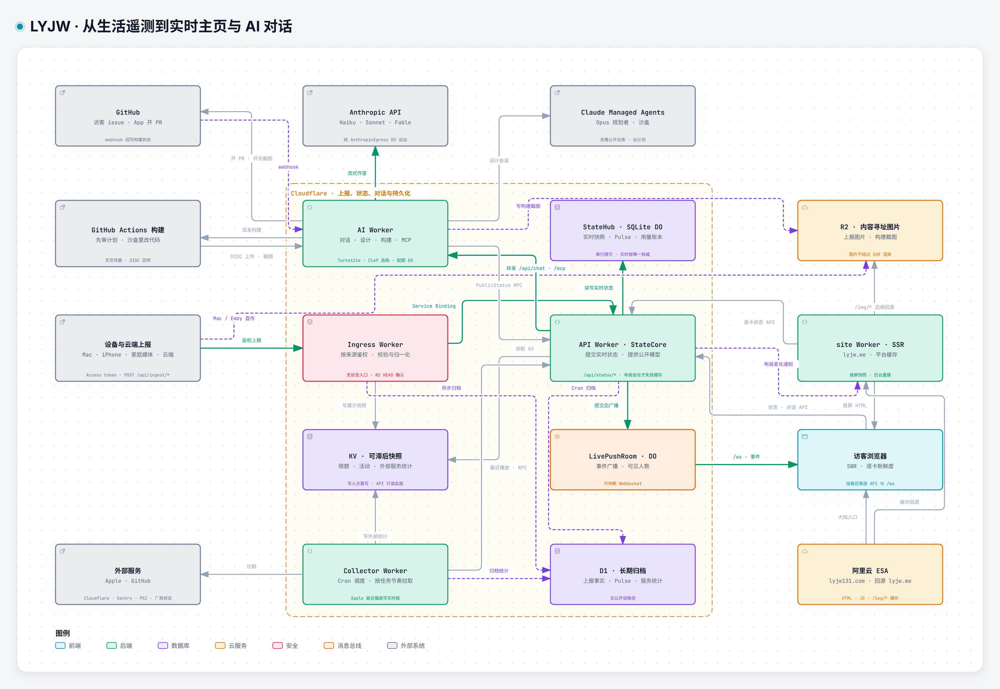
</picture>

- **采集端**跑在数据产生的地方：Mac、iPhone、NAS、Linux 上报器、Home Assistant、Claude Code 云端遥测；外部服务（Apple Music、GitHub、Cloudflare、PageSpeed）由采集 Worker 定时拉取。
- **状态中枢**：上报入口 Worker 在 Cloudflare Access 之后验身份、校验，实时数据交给持有 Durable Objects 的 core Worker，可滞后数据写 KV，归档进 D1，图片进 R2。
- **展示端**：site Worker 按卡读状态生成首页，之后由 WebSocket 推送与轮询追上；中国大陆入口经阿里云 ESA 加速。

[交互式架构图](https://lyjw131.github.io/lyjwpage/) · [页面细节与关键设计](./docs/design-notes.md)（首屏缓存、推送与轮询分工、旧页面降级、窗口标题隐私判断、图片寻址、可观测性）

## 技术组成

| 层次 | 主要技术 |
| --- | --- |
| 页面与类型 | React Router 8 · Vite · React 19（React Compiler） · TypeScript 7 |
| 样式与交互 | Tailwind CSS 4 · Motion · Number Flow · Geist |
| 客户端数据 | SWR · WebSocket |
| 状态与资源存储 | Cloudflare Workers · Durable Objects SQLite · KV · D1 · R2 |
| 活跃度评分 | Workers AI（Clef） |
| 首页对话 | Anthropic Claude（Clef 选档）、Cloudflare Turnstile |
| 原生设备接入 | Swift / SwiftUI · HealthKit · BLE |
| 页面托管与分发 | Cloudflare Workers · 阿里云 ESA |
| 报错与性能监控 | Cloudflare Workers Observability · Web Analytics |

## 从哪里读源码

| 想了解什么 | 阅读入口 |
| --- | --- |
| 首页如何组合各个模块 | [`src/app/page.tsx`](./src/app/page.tsx) · [`src/components/live/`](./src/components/live/) |
| 首屏如何按卡读取和缓存状态 | [`src/lib/first-screen.ts`](./src/lib/first-screen.ts) |
| 状态视图在两侧如何登记 | [`shared/status-views.ts`](./shared/status-views.ts) · [`workers/core/src/status-loaders.ts`](./workers/core/src/status-loaders.ts) |
| 推送与轮询如何更新同一份客户端状态 | [`src/hooks/use-live-events.ts`](./src/hooks/use-live-events.ts) · [`src/hooks/use-status.ts`](./src/hooks/use-status.ts) · [`src/lib/status-reads.ts`](./src/lib/status-reads.ts) |
| 网页播放器与歌词如何工作 | [`src/hooks/use-web-player.ts`](./src/hooks/use-web-player.ts) · [`src/hooks/use-lyrics.ts`](./src/hooks/use-lyrics.ts) |
| 上报如何鉴权、校验与按数据层拆分 | [`workers/ingress/`](./workers/ingress/) |
| 状态存储、实时推送与公开 API 如何组织 | [`workers/core/`](./workers/core/) |
| 首页对话、MCP 与模型工具如何运行 | [`workers/ai/`](./workers/ai/) |
| 各类设备与服务如何接入 | [`reporters/`](./reporters/) · [`workers/collector/`](./workers/collector/) |
| 原生 iOS App 如何读站点、如何上报 | [`apps/ios/`](./apps/ios/) |
| 在线访客如何统计 | [`workers/core/src/live-census.ts`](./workers/core/src/live-census.ts) · [`src/hooks/use-live-events.ts`](./src/hooks/use-live-events.ts) |

Mac 端采集器 [MacTelemetryHub](https://github.com/LYJW131/MacTelemetryHub) 以 submodule 接入 `reporters/mac-telemetry-hub/`。本地开发见 [`workers/core/README.md`](./workers/core/README.md)「本地开发」。

## 进一步了解

- [遥测与实时状态子系统](./docs/telemetry-subsystems.md)：各数据源的接入方式与协议
- [Worker 数据后端与首屏缓存](./docs/state-storage.md)：存储分层、公开数据边界与缓存失效
- [lyjwpage iOS App](./apps/ios/README.md)：原生客户端与 iPhone 端上报器
- [Discord Gateway 上报器](./reporters/discord-reporter/README.md)：Quest 游戏实时数据
- [文档索引](./docs/README.md)
