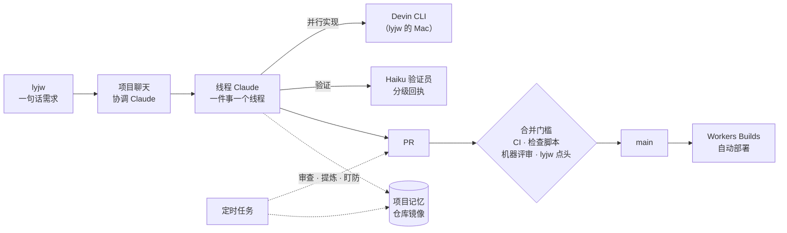

# 人与 agent 的开发工作流

> 类型：reference

这个仓库的代码大多由 Claude 写，lyjw 负责定方向、拍板和验收。本文讲这套协作怎么运转、靠什么守住质量。给 lyjw 的协作约定在 [`HUMAN.md`](../HUMAN.md)，给 agent 的硬规则在 [`AGENTS.md`](../AGENTS.md)；本文只讲全貌并指过去，不重复条款。

## 谁在干活

- **项目聊天里的协调 Claude**：接 lyjw 的每句话，新需求开线程，跟进转给对应线程，答项目层面的问题。
- **线程 Claude**：一件事一个线程、一个分支 `claude/project-thread-<id>`，从调研做到合并和上线核对。只在有结果、卡住或要 lyjw 决定时回复，平时只刷状态行。分叉用决策卡问，按推荐项先往下做。
- **lyjw Mac 上的会话**（Remote Control）：凭据、ssh 到自家机器、lyjw 的 `gh` 与浏览器登录态都在这里做，派法见 [`lyjwpage-mac-session`](../.claude/skills/lyjwpage-mac-session/SKILL.md)。能拆开的实现活经它派给 Devin CLI，一件事一个 worktree 并行跑，云端 Claude 审 diff、开 PR。
- **子代理**：翻文档、读长历史派 Sonnet / Haiku；验证一律派 Haiku 验证员（见下文「验证」）。

所有 Claude 共享一份项目记忆：lyjw 定的规矩、做过的决定写进去一次，之后每个线程都遵守。仓库里有去掉凭据和私有链接的镜像 [`.claude/memory/`](../.claude/memory/MEMORY.md)，由 `pnpm memory:mirror` 同步。

## 规则写在哪、由什么强制

规则分三层，越往下越硬：

| 层 | 文件 | 作用 |
| --- | --- | --- |
| 约定 | [`HUMAN.md`](../HUMAN.md) | lyjw 读的协作协议：什么自己定、什么等 lyjw、怎么汇报 |
| 指令 | [`AGENTS.md`](../AGENTS.md) 与各子目录 `AGENTS.md` | agent 读的硬规则、禁区、完成条件和事实源指针 |
| 流程 | [`.claude/skills/`](../.claude/skills/) | 可复用的做法：验证、排障、UI 自查、借鉴外部做法、各定时任务 |
| 强制 | 钩子、lint、检查脚本 | 违反就拦下，不靠记性 |

能做成机器检查的规则都做成检查，`AGENTS.md`「规则 → 由什么强制」一表列出每条规则由谁拦：

- **PreToolUse 钩子** [`scripts/guard-forbidden-commands.mjs`](../scripts/guard-forbidden-commands.mjs)：agent 发出的手动部署、强制提交本地凭据、改提交身份或关签名，命令还没跑就被拦下。
- **CI 门禁** [`scripts/ci-checks.sh`](../scripts/ci-checks.sh)：lint、typecheck、测试之外，还有 `docs:check`（文档链接与符号存在、不写时间线、类型与索引）、`rules:check`（仓库特有的写法约束）、`design:scale`（设计阶梯外的间距、字号、色值）、`ui:copy`（界面文案用英文）。
- **只减不增的基线**：存量违规记在基线文件里，`baselines:check` 让它们只能变少；例外只由 lyjw 打标签放行。

## 一次改动怎么走完

1. **读法**：需求有多种读法时，第一条回复先复述目标，同时按这个读法开做。
2. **实现**：可逆的事自己定，有影响的假设说一句。站点 UI 先读 [`DESIGN.md`](../DESIGN.md)，按 [`lyjwpage-ui-design`](../.claude/skills/lyjwpage-ui-design/SKILL.md) 自查；bug 先复现再修，按 [`lyjwpage-diagnose`](../.claude/skills/lyjwpage-diagnose/SKILL.md)。
3. **验证**：见下一节。
4. **合并**：门槛分档，见 [`HUMAN.md`「5. PR 与合并」](../HUMAN.md#5-pr-与合并)。大改逻辑的 PR 处理完 Claude、Codex、Devin 的机器评审，并由一个没写这段代码的 agent 判做没做完；UI 变化等 lyjw 看图点头；文档、skill 和小改动 CI 绿就合。合并提交由 `pnpm merge-message` 生成，正文汇总各提交的 `Co-Authored-By`，站点「最近提交」靠它显示参与的 agent 与模型。
5. **上线**：合进 main 由 Workers Builds 自动部署。「已部署」以 `/api/version` 返回的提交为准，再从生产域名核对受影响的行为。

所有等待（CI、机器评审、部署）都带上限，到点记失败、接着做不依赖它的事。

## 验证

主线程只定验什么、判结果；跑命令、开浏览器截图、轮询部署这些长输出的活交给 Haiku 验证员，做法见 [`lyjwpage-verify`](../.claude/skills/lyjwpage-verify/SKILL.md)。验证员最后签一张分级回执，按提交 SHA 记每项验到了哪一档（真页面、单测、只过类型），贴成 PR 评论；合并前 [`scripts/verify-receipt.ts`](../scripts/verify-receipt.ts) 核对回执还盖得住当前提交。

截图与效果图用同一份场景数据：`pnpm dev:scene` 把整页状态注入本地开发栈，`pnpm readme:shots` 出 README 的图，见 [screenshots.md](./screenshots.md)。

## 定时任务

几个 Claude Code 云端定时任务让项目在没人说话时也在演进，每个都按一份 skill 跑，时间与配置见 [ops-facts「Claude Code 云端 routine」](./ops-facts.md#claude-code-云端-routine)：

| 任务 | 做什么 |
| --- | --- |
| 每日代码审查 | 从上次游标起对 main 跑 `/code-review` 与 `/simplify`，值得改的开 PR；顺带找正在被复制的坏写法，升级成 lint 或检查 |
| 提炼 skill 与偏差复盘 | 读各线程，把反复出现的流程写成 skill；对照需求第一次怎么说、最后交付了什么，改 agent 的默认做法；被采纳的机器评审意见同类出现两次以上就做成检查（[`lyjwpage-skill-mining`](../.claude/skills/lyjwpage-skill-mining/SKILL.md)） |
| Anthropic 官方动态 | 拉官方博客、文档、更新日志和前沿作者的新内容，逐条判断能否吸收进本站（[`lyjwpage-anthropic-updates`](../.claude/skills/lyjwpage-anthropic-updates/SKILL.md)） |
| collector 盯防 | 盯采集 Worker 的公开状态与 Workers Observability 日志，找告警漏掉的细微异常，复现了的错误直接开修复草稿 PR（[`lyjwpage-collector-superfan`](../.claude/skills/lyjwpage-collector-superfan/SKILL.md)） |
| 记忆镜像同步 | 把项目记忆同步进 `.claude/memory/` |
| 晨报 | 读上面的报告，在项目聊天列出要 lyjw 决定的事 |

这些任务共守几条规矩：按游标不按时间窗，读失败就报失败、不推进书签，写操作确认成功才记账。依据见 [references.md「Agent 编排与定时自动化」](./references.md#agent-编排与定时自动化)。

## 访客也能改站点

首页「与神对话」里，任何访客都能描述想要的改动：Opus 规划者在只读沙盒里读代码、提问、写出计划，访客确认并授权 GitHub 后，`.github/workflows/build.yml` 让 Claude Code 先审计划、再在隔离环境里实现，产出 PR 交 lyjw 合并。安全边界与完整流程见 [访客协作构建](./build-routine.md)。

## 外部做法从哪来

这套流程大量借了外部的文章与仓库（Anthropic 工程博客、poteto 的 agent 实践等）。每借一处，在 [references.md](./references.md) 记链接、取了什么、落在哪些文件；评估流程见 [`lyjwpage-borrow`](../.claude/skills/lyjwpage-borrow/SKILL.md)。
